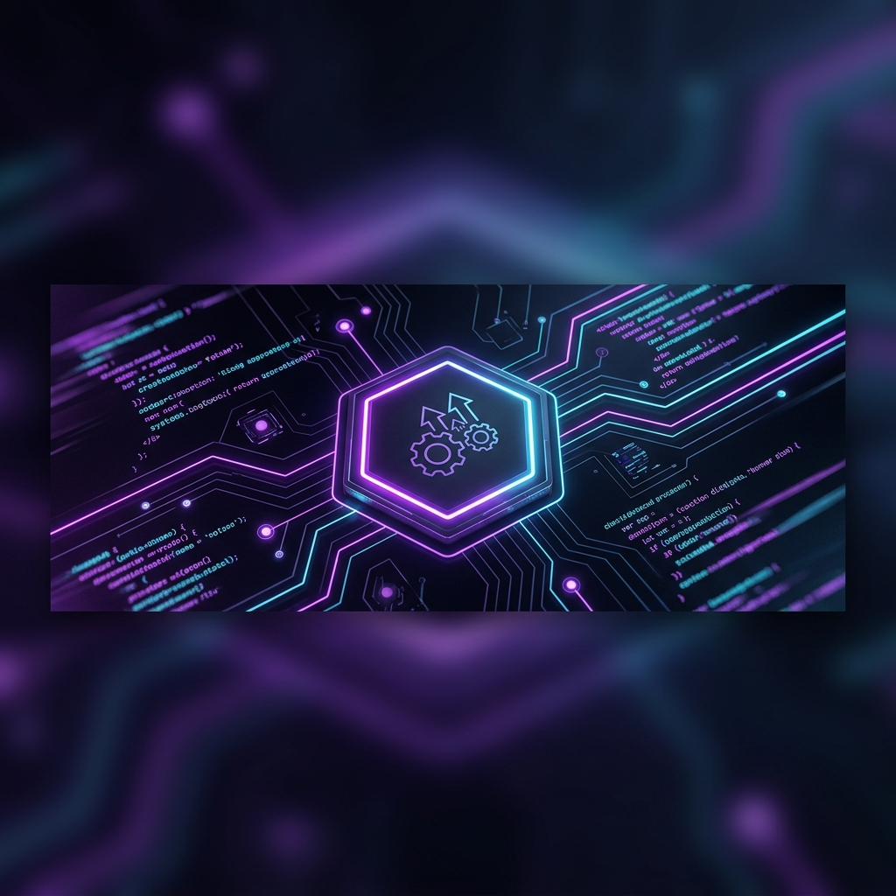

# 🌌 hc990275

### ✨ 追求极致效率的全栈开发者 / 自动化专家

---

### 🚀 核心使命
> **"专注通过代码消灭一切重复劳动。探索 AI 原生能力与日常工具的深度融合。"**

### 👨‍💻 关于我
- 🔭 **专注领域**：浏览器自动化、脚本开发、系统性能优化
- 💡 **开发理念**：**KISS** (Keep It Simple, Stupid) - 保持简单，拒绝过度工程
- ⚡ **效率准则**：如果你可以用代码完成，就别用鼠标。
- 🌱 **当前研究**：深入探索 LLM 辅助编程体系与端侧 AI 的私有化部署。

---

### 🛠️ 核心技术栈

  
  
  
  
  
  
  
  

---

### 📊 生态统计

  
  

  

---

### 🎮 贡献动态

  <picture>
    <source media="(prefers-color-scheme: dark)" srcset="https://raw.githubusercontent.com/hc990275/hc990275/output/github-contribution-grid-snake-dark.svg">
    <source media="(prefers-color-scheme: light)" srcset="https://raw.githubusercontent.com/hc990275/hc990275/output/github-contribution-grid-snake.svg">
    
  </picture>

---

### 📫 保持联系

  
  &nbsp;
  

 

  Last updated: 2024-04-17 (Version 1.1.0) | Built with ✨ and AI

